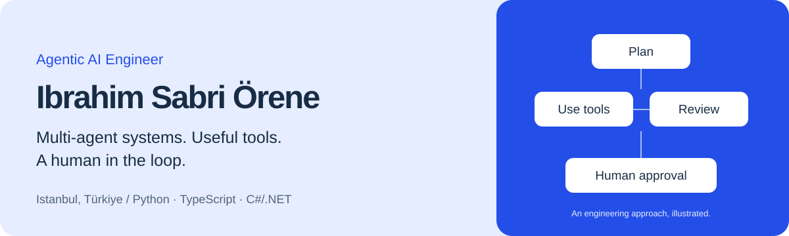

### I build agents with tools, context and a clear path to human review.

I'm **Ibrahim Sabri Örene**, an Agentic AI Engineer based in Istanbul, Türkiye. I work across multi-agent orchestration, custom MCP servers, RAG and the software around them, using Python, TypeScript and C#/.NET.

[Portfolio](https://ibrahimsabriorene.github.io/) · [LinkedIn](https://www.linkedin.com/in/ibrahimorene/) · [Email](mailto:ibrahimsabriorene@protonmail.com)

### Selected personal work

| Project | What I built or configured |
| --- | --- |
| **AI Orchestrator** | LangGraph software-team prototype with architect/reviewer roles, parallel backend/frontend work, test gates, bounded retries and human escalation. |
| **Paperclip agent teams** | Company-style agent roles, isolated Git worktrees and cross-model review, using the existing Paperclip platform. |
| **WhatsApp RAG** | Knowledge assistant with semantic and date-based retrieval, conversation context and a model-selected MCP date resolver. |
| **Addy AI** | Media-workflow prototype with checkpoints, human decisions, QA and bounded provider retries. Offline path implemented; live-provider release validation remains pending. |
| **Upwork MCP** | Job search, saved-search monitoring, events and proposal drafts. Submission stays with a human. |
| **Trendyol Milla MCP** | Browser-backed product search, filter discovery and structured results. |
| **Stellaris Teacher MCP** | Offline-first knowledge retrieval, BM25 search and terminology resolution. |
| **Warframe Guide MCP** | Wiki retrieval, fuzzy terminology matching and UI-label lookup for game guidance. |

These descriptions distinguish working source implementations, prototypes and team configurations. Public source links are included where available; other personal work is described on my portfolio.

### How I approach the work

- Define responsibilities, tool contracts and useful context before starting an agent.
- Make state, validation, retries and escalation explicit.
- Keep approval and cancellation usable parts of the workflow.
- Review outputs with test gates, offline checks and cross-model review where they help.

**Core tools:** LangGraph, MCP, Python, TypeScript/Node.js, Qdrant, React, C#/.NET, EF Core, DevExpress XAF and Git worktrees.

### Software foundations

Alongside agentic systems, I work with .NET applications, authentication and business-process automation. See my [DevExpress XAF OTP authentication sample](https://github.com/IbrahimSabriOrene/devexpress-xaf-otp-auth-theme).

At **Xenius Technology & Innovation**, also known as **Epoch Technology & Innovation**, my work progressed from **RPA Developer** (August 2024–February 2025) to **Agentic Engineer** (February 2025–present). This is one continuous employment period at the same company.

Associate Degree in Computer Programming, **Ege University** (2022–2024). English: **advanced**.

<strong>Türkçe</strong>

### Araç kullanan, bağlamı anlayan ve gerektiğinde insana danışan ajanlar geliştiriyorum.

İstanbul'da yaşayan **Ibrahim Sabri Örene**. Agentic AI Engineering odağında çok ajanlı orkestrasyon, özel MCP sunucuları, RAG ve bu sistemlerin etrafındaki yazılım üzerinde çalışıyorum.

Kişisel çalışmalarım arasında **AI Orchestrator**, **Paperclip ajan ekipleri**, **WhatsApp RAG**, **Addy AI** medya iş akışı prototipi ve **Upwork**, **Trendyol Milla**, **Stellaris Teacher**, **Warframe Guide** MCP sunucuları yer alıyor.

Yaklaşımım: sorumlulukları ayırmak, araç sözleşmelerini netleştirmek, durum ve yeniden denemeleri yönetmek, insan onayını akışa dahil etmek ve ajan çıktısını incelemek. Addy AI'ın canlı sağlayıcı ve yayın doğrulaması henüz tamamlanmadı.

**Xenius Technology & Innovation / Epoch Technology & Innovation** aynı şirketteki kesintisiz çalışma dönemim: **RPA Developer** (Ağustos 2024–Şubat 2025), ardından **Agentic Engineer** (Şubat 2025–devam ediyor).

**Ege Üniversitesi**, Bilgisayar Programcılığı ön lisans (2022–2024). İngilizce: **ileri düzey**.

[Portfolyo](https://ibrahimsabriorene.github.io/) · [LinkedIn](https://www.linkedin.com/in/ibrahimorene/) · [E-posta](mailto:ibrahimsabriorene@protonmail.com)

